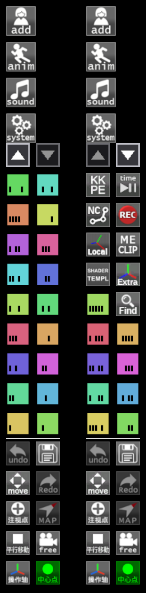

# KK_StudioToolbarScroll

[English](../../README.md) | [简体中文](../zh-CN/README.md) | **日本語**

コイカツ CharaStudio 用プラグインです。プラグインが増えるとスタジオ左側のツールバーが埋まり、収まらないボタンが画面の上端の外に出てしまいます。このプラグインは ▲▼ ボタンで、それらのボタンにも届くようにします。

> **状態：** 0.1.0、最初のリリース。KKAPI 1.45.1 と 1.48.1 でゲーム内テスト済みです。



ボタンが収まりきらないスタジオ左側のツールバーです。左：最初のページ。右：最上部までスクロールした状態で、▲ がグレーになります。Undo の上の細い線が、固定のボタンとスクロールするボタンを区切っています。（色付きの四角はデバッグ用のダミーボタンです。）

## 機能

- すべてのボタンが収まっているときは何もしません。
- 収まらないときは、スクロール領域の最上段が ▲ と ▼ のボタンになります。クリックで 1 行スクロール、押し続けると連続スクロールします。ホバーすると、その方向にあと何行残っているかが表示されます。
- ゲーム標準のボタン（Undo、Redo、Camera など）は固定で、スクロールするボタンとは細い線で区切られます。
- スタジオのメインメニュー（add、anim、sound など）に隠れる行は、使える領域に数えません。
- 2 列の外にドラッグしたボタンは、置いた場所に残ります。
- マウスホイールでのスクロールには対応しません。ホイールは 3D カメラのズームや多くのウィンドウが使っています。ホットキーは任意で割り当てられます（初期状態は未割り当て）。

## 必要環境

- コイカツ **CharaStudio**、BepInEx 5.4.x
- KKAPI（IllusionModdingAPI）1.45 以降

## インストール

1. 最新リリースから zip をダウンロードし、コイカツのフォルダに展開して、`KK_StudioToolbarScroll.dll` が `BepInEx/plugins` に入るようにします。
2. CharaStudio を起動します。ほかの設定は不要です。

## 設定（F1 → KK_StudioToolbarScroll）

| 設定 | 初期値 | 説明 |
|---|---|---|
| General / Language | Auto | 表示言語：自動、英語、簡体字中国語、日本語 |
| Hotkeys / Scroll up、Scroll down | 未割り当て | ツールバーを 1 行スクロール |
| Debug / Fake buttons | 0 | ダミーのボタンを追加して、はみ出しをテストします。通常は 0 のままにしてください |

## 既知の問題と注意

- **ツールバーの「編集モード」（Option ボタンを右クリック）は、できるだけ使わないでください。** このプラグインが原因の問題は今のところ見つかっていませんが、KKAPI 1.46 以降は編集モード中に普段は非表示のボタンも配置するため、Undo などの標準ボタンが 1 列右にずれることがあります（このプラグインがなくても起こります）。今後の KKAPI で新たな競合が起きる可能性も否定できません。配置が乱れたときは、同じメニューの *Rearrange buttons* で元に戻せます。
- **ゲーム標準のボタン（Undo、Redo、Camera など）はドラッグしないでください。** このプラグインは、それらが最下部にあることを前提にしています。空いたマスは KKAPI が他のボタンで埋め、固定の行とスクロールする行の境界線も一緒に動きます。

## トラブルシューティング

このプラグインは、動作（スクロール、ドラッグ、レイアウトの変更）を時刻付きで BepInEx のログに *Debug* レベルで書き出します。表示するには、`BepInEx/config/BepInEx.cfg` で `[Logging.Disk] Enabled = true` にし、`LogLevels` に `Debug` を加えて、`BepInEx/LogOutput.log` を見てください。

## ソースからのビルド

.NET SDK が必要です。`KKAPI.dll` はゲームフォルダから参照します。

```bash
cd src
dotnet build -c Release -p:GameDir="C:\path\to\Koikatu"
```

パスはリポジトリ直下の `GameDir.props` に書くこともできます。ビルド後、DLL は `GameDir\BepInEx\plugins` に自動でコピーされます。コピーしない場合は `-p:CopyToGame=false` を付けてください。

## ライセンス

本ソフトウェアは「現状のまま」提供され、いかなる保証もありません。自己責任でご利用ください。

Copyright (C) 2026 Hamakaze。[GNU General Public License v3.0 or later](../../LICENSE)（GPL-3.0-or-later）で公開します。KKAPI（LGPL-3.0）と BepInEx（LGPL-2.1）にリンクしますが、同梱や再配布はしません。
